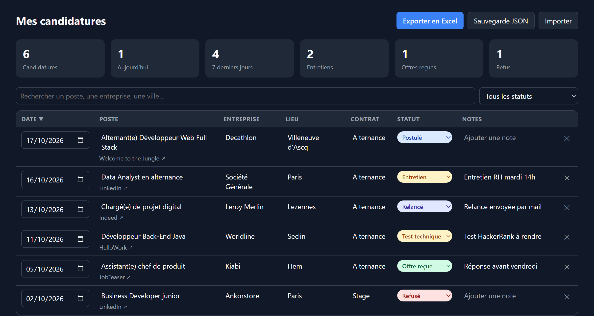
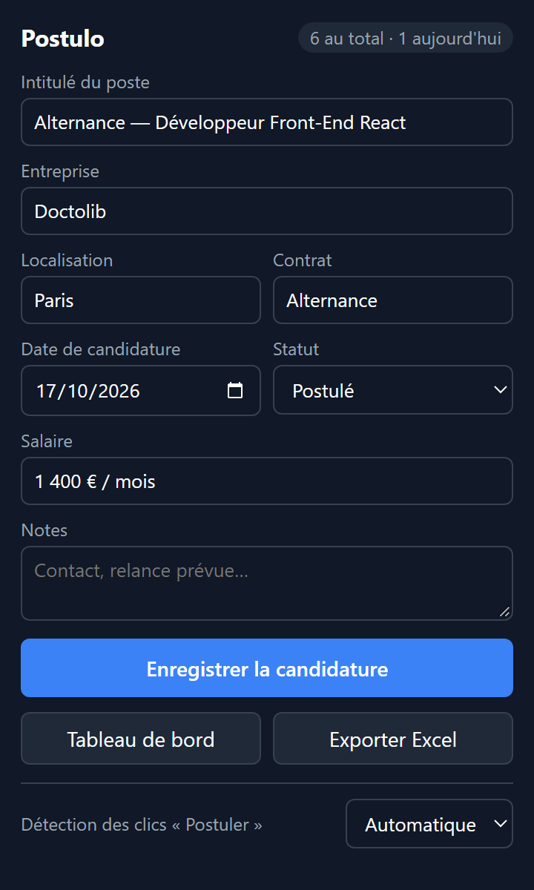

<div align="center">


# Postulo

**Ton suivi de candidatures, en automatique.**

Une extension Chrome qui enregistre chaque offre à laquelle tu postules (intitulé, entreprise, lieu, contrat, date…)<br/>
et exporte le tout dans un vrai fichier Excel, en un clic.


</div>

---

## Pourquoi ?

Quand on cherche une alternance, un stage ou un premier emploi, on envoie des dizaines de candidatures sur
LinkedIn, Indeed, Welcome to the Jungle… et on finit par ne plus savoir à qui on a écrit, quand, ni où on en est.

**Postulo** s'en charge pour toi : tu cliques sur « Postuler », l'offre est enregistrée. C'est tout.

## Aperçu

<table>
  <tr>
    <td width="70%"></td>
    <td width="30%"></td>
  </tr>
  <tr>
    <td align="center"><sub>Le tableau de bord : statistiques, recherche, statuts et notes modifiables</sub></td>
    <td align="center"><sub>Le popup, pré-rempli avec l'offre ouverte</sub></td>
  </tr>
</table>

## Fonctionnalités

- 🎯 **Détection automatique** : un clic sur « Postuler », « Candidature simplifiée », « Envoyer ma candidature »,
  « Apply »… ou l'apparition d'un message « Votre candidature a été envoyée » enregistre l'offre. Une petite bulle
  confirme l'ajout, avec un bouton **Annuler**.
- 🧠 **Lecture intelligente de l'offre** : intitulé, entreprise, localisation, type de contrat (alternance, stage,
  CDI…) et salaire quand il est indiqué.
- ✍️ **Ajout manuel** : clique sur l'icône (ou `Alt+Shift+S`) pour vérifier et corriger les infos avant d'enregistrer.
- 📊 **Tableau de bord** : statistiques, recherche, tri et suivi du statut
  (Postulé → Relancé → Entretien → Test technique → Offre reçue / Refusé).
- 📗 **Export Excel (.xlsx)** : en-têtes figés, filtres sur chaque colonne, dates au bon format, lien cliquable
  vers l'offre et nombre de jours écoulés depuis la candidature.
- 🔁 **Pas de doublons** : une même offre n'est jamais enregistrée deux fois, même sous une autre URL.
- 🔒 **Respect de la vie privée** : tout reste dans ton navigateur, rien n'est envoyé sur un serveur.
- 🌙 **Thème clair et sombre** selon ton système.

## Installation

> Postulo n'est pas (encore) sur le Chrome Web Store : on l'installe en mode développeur, ça prend 30 secondes.

1. Télécharge le projet : **Code → Download ZIP** puis décompresse-le (ou `git clone`).
2. Ouvre `chrome://extensions` dans Chrome.
3. Active le **Mode développeur** (en haut à droite).
4. Clique sur **Charger l'extension non empaquetée** et sélectionne le dossier du projet.
5. Épingle Postulo dans la barre d'outils (icône 🧩 → 📌).

Fonctionne aussi sur Edge, Brave, Opera et les autres navigateurs basés sur Chromium.

## Utilisation

| Je veux… | Comment |
| --- | --- |
| Enregistrer une candidature | Clique sur « Postuler » sur le site, Postulo s'occupe du reste |
| Ajouter ou corriger une offre | Clique sur l'icône Postulo (`Alt+Shift+S`) |
| Suivre mes candidatures | Popup → **Tableau de bord** |
| Récupérer mon Excel | **Exporter Excel** (popup ou tableau de bord) |
| Choisir le mode de détection | En bas du popup : *Automatique*, *Demander* ou *Désactivée* |
| Sauvegarder mes données | Tableau de bord → **Sauvegarde JSON** (et **Importer** pour restaurer) |

### Colonnes du fichier Excel

`Date de candidature` · `Intitulé du poste` · `Entreprise` · `Localisation` · `Type de contrat` · `Salaire` ·
`Statut` · `Jours écoulés` · `Source` · `Lien de l'offre` · `Notes`

## Sites compatibles

| Site | Prise en charge |
| --- | --- |
| LinkedIn, Indeed, Welcome to the Jungle | Lecture spécifique au site |
| HelloWork, APEC, France Travail, JobTeaser, La bonne alternance, Glassdoor, Meteojob… | Données structurées `JobPosting` |
| Greenhouse, Lever, Workday, Teamtailor, SmartRecruiters, Ashby, sites carrière | Données structurées `JobPosting` + titre de la page |

Les sites d'emploi changent régulièrement leurs pages : si un champ est mal lu, corrige-le dans le popup ou le
tableau de bord.

## Sous le capot

- **Manifest V3**, JavaScript natif, **aucune dépendance** ni étape de build.
- Le fichier `.xlsx` est généré par un petit writer maison ([`lib/xlsx.js`](lib/xlsx.js)), car une extension MV3
  ne peut pas charger de librairie distante.
- Les données sont stockées dans `chrome.storage.local`.

```
manifest.json          Configuration de l'extension (MV3)
background.js          Service worker : enregistrement, badge des candidatures du jour
content.js             Lecture de l'offre + détection des clics « Postuler »
lib/storage.js         Lecture/écriture des candidatures, dédoublonnage
lib/xlsx.js            Générateur .xlsx sans dépendance
lib/export.js          Mise en forme de l'export Excel
popup/                 Fenêtre ouverte depuis l'icône
dashboard/             Tableau de bord
```

### Permissions demandées

| Permission | Pourquoi |
| --- | --- |
| `storage` | Garder tes candidatures dans le navigateur |
| `activeTab`, `scripting` | Lire l'offre de l'onglet ouvert quand tu cliques sur l'icône |
| Accès aux sites (`<all_urls>`) | Détecter le bouton « Postuler » sur n'importe quel site d'emploi ou site carrière |

## Feuille de route

- [ ] Rappels de relance après X jours sans réponse
- [ ] Synchronisation avec Google Sheets
- [ ] Publication sur le Chrome Web Store
- [ ] Graphiques d'évolution des candidatures

## Contribuer

Une offre mal lue sur un site ? Une idée ? Ouvre une *issue* ou une *pull request*, avec l'URL de l'offre
si possible.

## Licence

[MIT](LICENSE) © 2026 Yanis Hubert
